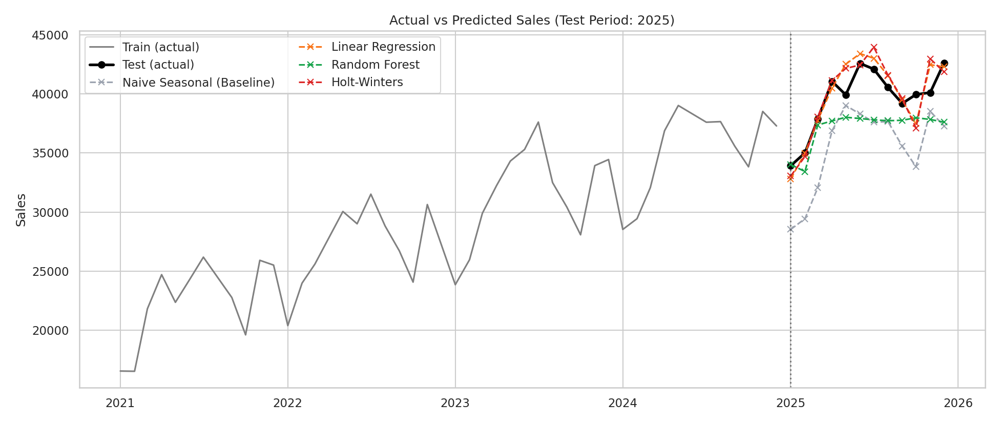
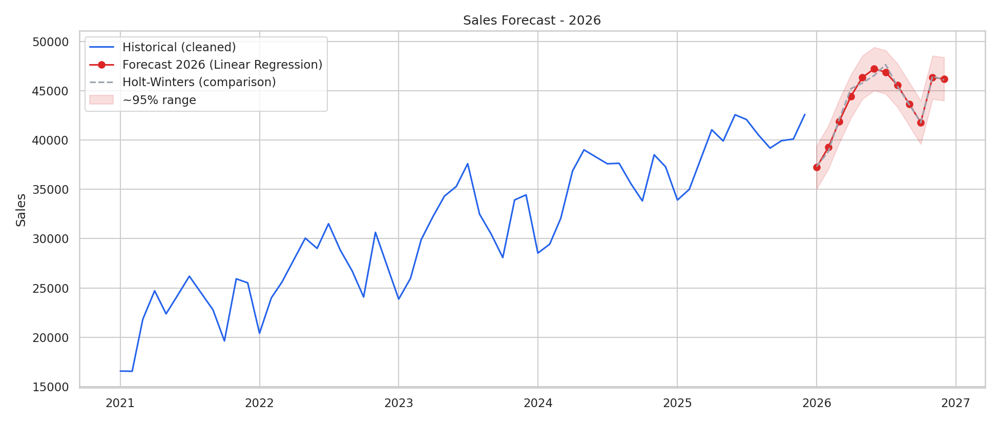

<div align="center">


# 📈 Predictive Analytics Using Historical Data

**Historical sales data se future trends forecast karne wala machine learning project**


</div>

---

## 📌 Table of Contents
- [Overview](#-overview)
- [Key Highlights](#-key-highlights)
- [Dataset](#-dataset)
- [Methodology](#-methodology)
- [Visual Walkthrough](#-visual-walkthrough)
- [Results](#-results)
- [Project Structure](#-project-structure)
- [Getting Started](#-getting-started)
- [Limitations and Future Scope](#-limitations-and-future-scope)
- [Author](#-author)

---

## 📖 Overview
Business decisions jaise inventory planning, staffing aur marketing budget future demand par depend karte hain. Is project mein **5 saal ke historical monthly sales data** se predictive models banaye gaye hain jo trend aur seasonality samajh kar **agle 12 mahine ka sales forecast** dete hain.

**Objectives**
- Historical dataset ko clean aur preprocess karna
- Regression aur time-series models se prediction karna
- Model accuracy evaluate karna aur predictions visualize karna

## ✨ Key Highlights
- Data cleaning: **robust outlier detection** (rolling median + MAD) aur **time-based interpolation**
- **Trend + seasonality decomposition** se data patterns samjhe
- **4 models compare** kiye: Naive Baseline, Linear Regression, Random Forest, Holt-Winters
- **Time-based train/test split** (random split nahi, taaki data leakage na ho)
- Evaluation metrics: **MAE, RMSE, MAPE, R-squared**
- **2026 ka 12-month forecast** confidence range ke saath

## 📊 Dataset
Retail store ka **monthly sales data (Jan 2021 - Dec 2025), 60 records**, jisme trend, yearly seasonality (Nov-Dec festive peak) aur noise hai. Real-world jaisa banane ke liye **3 missing values aur 2 outliers** jaan-boojh kar daale gaye hain.

> **Note:** Dataset *synthetic* hai (notebook mein code se generate kiya gaya hai), real company ka data nahi hai.

## 🔬 Methodology
| Step | Description |
|---|---|
| 1. Cleaning | Outlier detection (rolling median + MAD), missing values ke liye time interpolation |
| 2. Analysis | Seasonal decomposition, year-wise seasonality comparison |
| 3. Feature Engineering | Time index, cyclic month encoding (sin/cos), festive flag, 12-month lag |
| 4. Split | Train: 48 months (2021-2024), Test: 12 months (2025) |
| 5. Modeling | Naive Seasonal, Linear Regression, Random Forest, Holt-Winters |
| 6. Evaluation | MAE, RMSE, MAPE, R-squared, residual analysis |
| 7. Forecast | Best model ko poore data par retrain karke 2026 forecast |

## 🖼️ Visual Walkthrough

### 1. Data Cleaning
Raw data mein missing values aur outliers the (red dots). Cleaning ke baad data model-ready ho gaya.

<p align="center">
  
  
</p>

### 2. Trend and Seasonality
Data ko trend, seasonal aur residual components mein todke dekha. Har saal same seasonal pattern repeat hota hai.

<p align="center">
  
</p>
<p align="center">
  
</p>

### 3. Model Comparison
<p align="center">
  
</p>

### 4. Actual vs Predicted (Test Period: 2025)
<p align="center">
  
</p>

### 5. Residual Analysis (Best Model)
<p align="center">
  
</p>

### 6. Sales Forecast for 2026
<p align="center">
  
</p>

---

## 📈 Results

### Model Comparison (Test Period: 2025)
| Model | MAE | RMSE | MAPE (%) | R² |
|---|---|---|---|---|
| **Linear Regression** | **1047.46** | **1374.82** | **2.63** | **0.73** |
| Holt-Winters | 1128.46 | 1507.86 | 2.83 | 0.68 |
| Random Forest | 2486.69 | 2910.02 | 6.09 | -0.21 |
| Naive Seasonal (Baseline) | 4177.42 | 4472.12 | 10.70 | -1.86 |

### Key Insights
- **Linear Regression** (trend + seasonality features) sabse best raha, **MAPE sirf 2.63%**.
- **Holt-Winters** bhi usse kaafi close raha, aur dono ne naive baseline ko clearly beat kiya.
- **Random Forest** weak raha kyunki tree-based models training range ke bahar **trend extrapolate nahi kar paate**, ye time-series ki known limitation hai.
- Forecast ke hisaab se 2026 mein total sales **~11% growth** ke saath lagbhag **527k** rehne ka estimate hai (2025 ke ~475k ke muqable).
- Sales ka peak **mid-year (May-Jul)** aur **festive season (Nov-Dec)** mein dikhta hai.

## 📁 Project Structure
```
predictive-analytics-historical-data/
├── Predictive_Analytics_Historical_Data.ipynb   # Main notebook (code + outputs)
├── historical_sales_raw.csv                     # Raw dataset (missing values + outliers ke saath)
├── forecast_2026.csv                            # 2026 forecast with range
├── banner.png                                   # README banner
├── 01_raw_sales.png
├── 02_cleaned_sales.png
├── 03_decomposition.png
├── 04_seasonality.png
├── 05_model_comparison.png
├── 06_actual_vs_predicted.png
├── 07_residuals.png
├── 08_future_forecast.png
└── README.md
```

## 🚀 Getting Started
```bash
# 1. Repository clone karo
git clone https://github.com/monikakri08/predictive-analytics-historical-data.git
cd predictive-analytics-historical-data

# 2. Dependencies install karo
pip install pandas numpy scikit-learn statsmodels matplotlib seaborn jupyter

# 3. Notebook run karo
jupyter notebook Predictive_Analytics_Historical_Data.ipynb
```

## ⚠️ Limitations and Future Scope
**Limitations**
- Dataset synthetic hai; real data mein promotions, holidays aur economic events jaise external factors bhi hote hain.
- Sirf 60 data points hain, isliye complex models (deep learning) ke liye data kam hai.

**Future Scope**
- SARIMA / Prophet / LSTM models
- External features (holidays, promotions, weather)
- `TimeSeriesSplit` se cross-validation
- Streamlit dashboard

## 👩‍💻 Author
**Monika**
[GitHub](https://github.com/monikakri08)

---
<div align="center">⭐ Agar ye project pasand aaya to repo ko star zaroor karein!</div>
